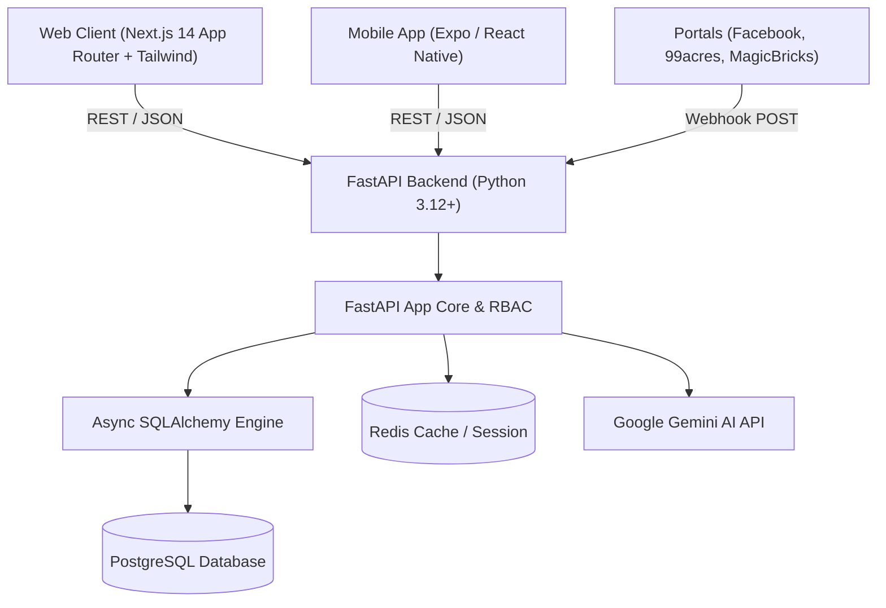

# 🏢 PropForce — Real Estate CRM & Sales ERP Platform

[](https://nextjs.org/)
[](https://fastapi.tiangolo.com/)
[](https://expo.dev/)
[](https://tailwindcss.com/)
[](LICENSE)

**PropForce** is a next-generation, multi-tenant Real Estate Customer Relationship Management (CRM) and Sales Enterprise Resource Planning (ERP) platform. Designed specifically for property developers, real estate agencies, builders, and channel partner networks, it streamlines the full lifecycle of property inquiries—from omnichannel lead ingestion and automated dialer outreach to site visit tracking, AI-powered property matching, and final unit booking.

---

## 🌟 Key Features & Business Capabilities

### 1. 🎯 Omnichannel Lead Ingestion & Distribution
- **Portal Webhook Integrations**: Instant auto-capture of leads from Facebook Lead Ads, 99acres, MagicBricks, Housing.com, and custom landing page forms.
- **Bulk CSV / Excel Importer**: 1-click import modal for raw lead lists with field mapping, duplicate sanitization, and automatic assignment.
- **Intelligent Round-Robin Distribution**: Fair-share algorithm automatically assigns incoming leads across telecallers and sales executives.

### 2. 📊 Interactive Sales Pipeline & Funnel Visualization
- **7-Stage Visual Kanban Board**: Tracks deals across *New Lead → Contacted → Site Visit → Negotiation → Under Review → Booking Done → Won / Lost*.
- **Clickable Funnel Metrics Cards**: Stage count cards link directly to the pipeline, auto-scrolling to and highlighting selected stage columns.
- **Real-Time Drag & Drop**: Smooth status transitions with automatic lead activity logging.

### 3. 👥 Multi-Role Real Estate Team Management
- **Role-Based Access Control (RBAC)**: Tailored operational views for:
  - **Company Admin / Director**: High-level revenue intelligence, team leaderboards, lead reassignments, and system audits.
  - **Sales Head / Manager**: Team performance monitoring, unassigned lead pool management, and escalation handling.
  - **Telecallers / Pre-Sales**: Focused call queues, follow-up scheduling, and lead qualification checklist.
  - **Field Sales Executives**: Site visit itineraries, property catalogs, and unit booking forms.
- **Live Persona Switcher**: Test and operate across different user roles seamlessly in development and staging environments.

### 4. 📜 Lead 360° Profile History & Audio Player
- **Complete Timeline Journey**: Comprehensive audit trail capturing initial inquiry timestamp, assigned caller notes, follow-up schedule, and stage updates.
- **Built-in Call Recording Player**: Interactive audio player with custom waveform scrubber, playback speed controls, and timestamped call transcripts for quality auditing.
- **Confidential Management Notes**: Private remarks visible only to administrators and team heads.
- **1-Click Client Dossier Export**: Generate clean, printable executive dossiers summarizing lead requirements, engagement history, and recommended inventory.

### 5. 🤖 AI-Powered Smart Property Matchmaker
- **Property Inventory Catalog**: Comprehensive listings for Residential Apartments, Luxury Villas, Plots, and Commercial units with pricing, carpet area, configuration, and RERA status.
- **Client-to-Inventory Match Engine**: Real-time algorithm compares client budget, location preference, and required BHK against live inventory to generate prioritized recommendations with match percentages.
- **Instant Pitch Sheet**: Callers can view matches during calls and quote matching inventory directly to clients.

### 6. 📞 Callen Cloud Dialer & Follow-up Automation
- **Integrated Click-to-Dial Modal**: Initiate client calls directly from the CRM web dashboard or mobile app.
- **Disposition Logging**: Immediate logging of call outcomes (Connected, Busy, Callback Requested, Site Visit Scheduled, Not Interested).
- **Missed Follow-up Audio Alerts**: Chime notifications alert telecallers when scheduled follow-ups are overdue.

### 7. 📱 Cross-Platform Mobile Application
- **Built with Expo (React Native)**: Native companion app for on-the-go site visits and field sales reps.
- **Native Communication Intents**: 1-tap Click-to-Call (`tel:`) and instant WhatsApp chat (`whatsapp://`) triggers with prefilled property details.

---

## 🛠️ Architecture & Tech Stack



### Frontend
- **Framework**: [Next.js 14](https://nextjs.org/) (App Router, Server & Client Components)
- **Language**: TypeScript (Strict typing)
- **Styling**: [Tailwind CSS](https://tailwindcss.com/) with Dark Glassmorphism design tokens
- **Components**: [shadcn/ui](https://ui.shadcn.com/) (Radix UI primitives)
- **State & Data Fetching**: [TanStack Query v5](https://tanstack.com/query), [Zustand](https://zustand-demo.pmnd.rs/)
- **Charts**: [Recharts](https://recharts.org/) & Lucide React icons

### Backend
- **Framework**: [FastAPI](https://fastapi.tiangolo.com/) (Python 3.12+)
- **ORM**: [SQLAlchemy 2.0](https://www.sqlalchemy.org/) (Async engine)
- **Migrations**: [Alembic](https://alembic.sqlalchemy.org/)
- **Database**: PostgreSQL with UUID primary keys & multi-tenant isolation
- **Security**: JWT tokens (python-jose), bcrypt password hashing, RBAC permissions matrix
- **AI Engine**: Google Gemini API for automated lead scoring and personalized messaging

### Mobile
- **Framework**: [React Native](https://reactnative.dev/) with [Expo Router v3](https://docs.expo.dev/router/introduction/)
- **Storage**: Expo SecureStore for encrypted token persistence
- **Intents**: Native Linking for phone dialer and WhatsApp integration

---

## 📂 Repository Structure

```
propforce/
├── backend/                  # FastAPI asynchronous REST backend
│   ├── alembic/              # Database migration environments
│   ├── app/
│   │   ├── api/v1/           # API routes (auth, leads, pipelines, properties, ai)
│   │   ├── core/             # Security, middleware, pagination, RBAC
│   │   ├── db/               # Async engine and database session setup
│   │   ├── models/           # SQLAlchemy database models
│   │   ├── schemas/          # Pydantic v2 validation models
│   │   ├── services/         # Business logic layer
│   │   └── utils/            # Phone normalization and utilities
│   ├── requirements.txt      # Python dependencies
│   └── alembic.ini
│
├── frontend/                 # Next.js 14 web application
│   ├── public/               # Static assets and demo files
│   ├── src/
│   │   ├── app/              # App router pages (dashboard, leads, pipeline, properties)
│   │   ├── components/       # UI primitives, layout, lead modals, audio players
│   │   ├── hooks/            # TanStack Query custom data hooks
│   │   ├── lib/              # Axios client, types, utility helpers
│   │   └── providers/        # Query and Auth providers
│   ├── package.json
│   └── tailwind.config.ts
│
├── mobile/                   # Expo React Native mobile application
│   ├── app/                  # Expo Router mobile screens
│   ├── components/           # Mobile UI components
│   ├── hooks/                # Mobile API and auth hooks
│   └── package.json
│
├── docker-compose.yml        # Multi-container orchestration (Backend + Postgres + Redis)
├── .env.example              # Environment variables template
└── README.md                 # Project documentation
```

---

## 🚀 Getting Started

### Prerequisites
- **Node.js**: v18.17.0+ or v20+
- **Python**: v3.11+ or v3.12+
- **PostgreSQL** & **Redis** (or Docker)
- **Git**

---

### 1. Backend Setup

```bash
cd backend

# Create and activate virtual environment
python -m venv venv
# Windows:
venv\Scripts\activate
# Linux/macOS:
source venv/bin/activate

# Install dependencies
pip install -r requirements.txt

# Configure environment variables
cp ../.env.example .env
# Edit .env with your DATABASE_URL, SECRET_KEY, and GEMINI_API_KEY

# Seed initial system roles and permissions
python -m app.seeds.seed_roles

# Start FastAPI development server
uvicorn app.main:app --reload --host 0.0.0.0 --port 8000
```
Interactive API documentation will be available at: `http://localhost:8000/docs`

---

### 2. Frontend Setup

```bash
cd frontend

# Install npm dependencies
npm install

# Start Next.js development server
npm run dev
```
Open your browser at `http://localhost:3000` to access the CRM platform.

---

### 3. Mobile App Setup (Optional)

```bash
cd mobile

# Install dependencies
npm install

# Start Expo development server
npx expo start
```
Scan the QR code using the **Expo Go** app on Android or iOS.

---

### 4. Docker Quickstart (Full Stack)

```bash
# From the project root
docker-compose up -d --build
```
This boots up PostgreSQL, Redis, and the FastAPI backend service together.

---

## 🔒 Security & Data Isolation
- **Multi-Tenant Separation**: Every database query is strictly partitioned by `organization_id` derived directly from validated JWT tokens.
- **Granular RBAC**: Endpoint decorators enforce specific resource and action requirements (e.g. `@require_permission('leads', 'assign')`).
- **Encrypted Storage**: Client data, sensitive manager notes, and webhook secrets are stored with encryption standards.

---

## 👨‍💻 Author & Contribution

- **Author**: Harsh Singh ([harshharshsingh1@gmail.com](mailto:harshharshsingh1@gmail.com))
- **GitHub Repository**: [https://github.com/furperfect2026/Real-Estate-CRM-Project](https://github.com/furperfect2026/Real-Estate-CRM-Project)

---

## 📄 License
This project is licensed under the [MIT License](LICENSE).
